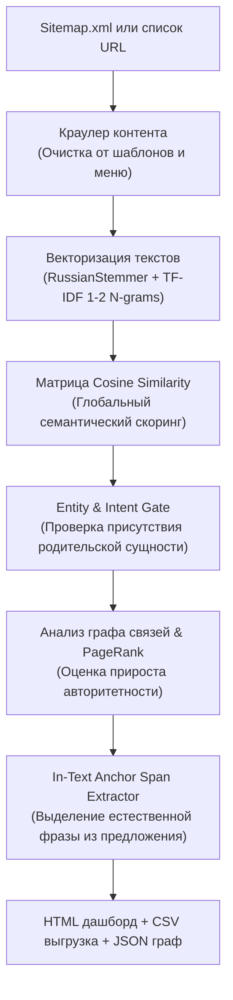

# Vector Semantic Linker v2.0 — Antigravity Plugin

[](LICENSE)
[]()
[]()
[]()

> Интеллектуальный SEO-плагин для Antigravity CLI, выстраивающий естественную перелинковку сайта на основе двухэтапного семантического отбора: Entity & Intent Gating, векторных эмбеддингов (TF-IDF N-grams, Cosine Similarity), моделирования графа PageRank и точного извлечения контекстных анкор-фраз прямо из текста предложений.

---

## 🎯 Проблема и решение

| Традиционная перелинковка | Векторная семантическая перелинковка (Vector Linker v2.0) |
| :--- | :--- |
| Спамные ссылки по точным вхождениям ключей (риск фильтров Баден-Баден / Penguin) | Двухэтапный отбор: проверка смысловой сущности (Head Entity Gate) + векторный расчет близости |
| Нелепые рекомендации из-за случайных совпадений слов (напр. коляски в обувной статье) | Строгий шлюз родительской сущности (Entity Gate) блокирует нерелевантные коммерческие ветки |
| Вставка искусственных анкоров, ломающих грамматику и читаемость текста | Выделение естественных словосочетаний (1–4 слова) непосредственно из тела предложения-донора |
| Ссылки ставятся в шаблонные блоки («Читайте также», сквозные меню) | Алгоритм находит конкретное предложение внутри текста статьи и органично встраивает анкор |
| Непонятно распределение ссылочного веса | Встроенная математическая модель ориентированного графа PageRank до и после внедрения |

---

## 🏗 Архитектура работы (v2.0 Pipeline)



---

## 🚀 Что нового в версии 2.0

1. **Entity & Category Intent Gate**:
   - Категории каталога разделяются на главные сущности (*обувь, ботинки, коляски, куртки*) и демографические/функциональные уточнения (*для девочек, детские, весенние*).
   - Ссылка разрешается только при наличии подтвержденной сущности в анализируемом фрагменте статьи.
2. **In-Text Anchor Span Extractor**:
   - Вместо подстановки «сырого» заголовка категории алгоритм находит точный фрагмент (1–4 слова: прилагательное + существительное + зависимые слова), уже присутствующий в предложении.
3. **Адаптивный порог релевантности (Adaptive Relevance Floor)**:
   - Отсекает низкорелевантный шум: если релевантна только одна категория, алгоритм рекомендует ровно одну ссылку, не навязывая случайные товары.

---

## 🚀 Установка

### В глобальную конфигурацию Antigravity CLI:
```bash
git clone https://github.com/aristovyura23123-commits/antigravity-vector-linker.git ~/.gemini/config/plugins/vector-linker
```

### В проектный каталог агента:
```bash
git clone https://github.com/aristovyura23123-commits/antigravity-vector-linker.git .agents/plugins/vector-linker
```

### Зависимости:
```bash
pip install scikit-learn nltk numpy beautifulsoup4
```

---

## 💻 Использование через CLI

### 1. Анализ по Sitemap.xml
```bash
python3 scripts/linker_cli.py \
  --sitemap "https://example.com/sitemap.xml" \
  --articles-pattern "/articles/|/blog/|/news/" \
  --catalog-pattern "/catalog/|/services/|/products/" \
  --output-html "report.html" \
  --output-csv "report.csv"
```

### 2. Анализ по заданным спискам URL
```bash
python3 scripts/linker_cli.py \
  --articles-urls "url1,url2,url3" \
  --categories-urls "cat1,cat2" \
  --output-html "report.html"
```

---

## 📊 Результаты работы

1. **Интерактивный HTML-дашборд**: визуальная таблица рекомендаций, подсвеченные предложения в статьях, прирост PageRank.
2. **CSV-отчёт для контентщиков**: готовый файл со столбцами `Статья URL`, `Каталог URL`, `Предложение-контекст`, `Рекомендуемый анкор`.
3. **JSON-граф**: матрица смежности и узлы для визуализации графа связей.

---

## 🧪 Тестирование

Запуск модульных тестов:
```bash
python3 -m unittest tests/test_engine.py
```

---

## 📄 Лицензия

MIT License (c) 2026 aristovyura23123-commits.
