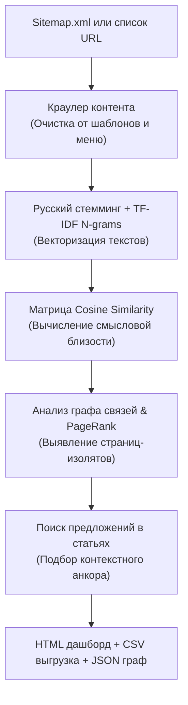

# Vector Semantic Linker — Antigravity Plugin

[](LICENSE)
[]()
[]()

> Интеллектуальный SEO-плагин для Antigravity CLI, выстраивающий естественную перелинковку сайта на основе векторных эмбеддингов, косинусного сходства (Cosine Similarity), моделирования графа внутреннего PageRank и автоматического подбора контекстных анкоров.

---

## 🎯 Проблема и решение

| Традиционная перелинковка | Векторная семантическая перелинковка (Vector Linker) |
| :--- | :--- |
| Спамные ссылки по точным вхождениям ключей (риск текстовых фильтров поисковиков) | Ссылки строятся на основе глубокого смыслового совпадения темы статьи и категории |
| Ручной подбор страниц занимает недели на больших сайтах | Автоматический краулинг sitemap.xml и расчет матрицы сходства за секунды |
| Ссылки ставятся в шаблонные блоки («Читайте также», сквозные меню) | Алгоритм находит конкретное предложение внутри текста статьи и органично встраивает анкор |
| Непонятно распределение ссылочного веса | Встроенная математическая модель ориентированного графа PageRank до и после внедрения |

---

## 🏗 Архитектура работы



---

## 🚀 Установка

### В глобальную конфигурацию Antigravity CLI:
```bash
git clone https://github.com/aristovyura23123-commits/antigravity-vector-linker.git ~/.gemini/config/plugins/vector-linker
```

### В проектный каталог агента:
```bash
git clone https://github.com/aristovyura23123-commits/antigravity-vector-linker.git .agents/plugins/vector-linker
```

### Зависимости:
```bash
pip install scikit-learn nltk numpy beautifulsoup4
```

---

## 💻 Использование через CLI

### 1. Анализ по Sitemap.xml
```bash
python3 scripts/linker_cli.py \
  --sitemap "https://example.com/sitemap.xml" \
  --articles-pattern "/articles/|/blog/|/news/" \
  --catalog-pattern "/catalog/|/services/|/products/" \
  --output-html "report.html" \
  --output-csv "report.csv"
```

### 2. Анализ по заданным спискам URL
```bash
python3 scripts/linker_cli.py \
  --articles-urls "url1,url2,url3" \
  --categories-urls "cat1,cat2" \
  --output-html "report.html"
```

---

## 📊 Результаты работы

1. **Интерактивный HTML-дашборд**: визуальная таблица рекомендаций, подсвеченные предложения в статьях, прирост PageRank.
2. **CSV-отчёт для контентщиков**: готовый файл со столбцами `Статья URL`, `Каталог URL`, `Предложение-контекст`, `Рекомендуемый анкор`.
3. **JSON-граф**: матрица смежности и узлы для визуализации графа связей.

---

## 🧪 Тестирование

Запуск модульных тестов:
```bash
python3 -m unittest tests/test_engine.py
```

---

## 📄 Лицензия

MIT License (c) 2026 aristovyura23123-commits.
