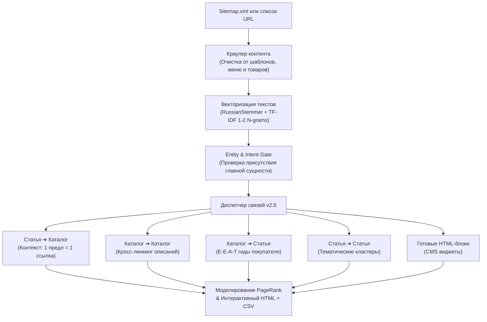

# Vector Semantic Linker v2.5 — Antigravity Plugin

[](LICENSE)
[]()
[]()
[]()

> Профессиональный многонаправленный SEO-плагин для Antigravity CLI, выстраивающий полную ссылочную экосистему сайта: контекстные ссылки (Статья ➔ Каталог, Каталог ➔ Каталог, Каталог ➔ Статья), тематические кластеры и готовые HTML-блоки (виджеты) для CMS. Строгая гарантия уникальности: **1 предложение = не более 1 ссылки**.

---

## 🎯 Проблема и решение

| Традиционная перелинковка | Векторная семантическая перелинковка (Vector Linker v2.5) |
| :--- | :--- |
| Несколько ссылок на одно и то же предложение или пересекающийся анкор | **Строгая дедупликация**: 1 предложение = строго 1 ссылка, уникальные анкоры на каждой странице |
| Перелинковываются только статьи, а описания категорий каталога игнорируются | **Кросс-линкинг Каталог ➔ Каталог**: алгоритм сканирует описания категорий и связывает смежные товарные ветки |
| Не учитываются экспертные гиды покупателя | **E-E-A-T связка Каталог ➔ Статья**: страницы каталога ссылаются на авторитетные гиды по выбору |
| Требуется ручная правка десятков абзацев контент-менеджерами | **Генератор готовых блоков перелинковки**: готовые адаптивные HTML-виджеты с кнопкой копирования для CMS |
| Риск санкций за неестественные анкоры | Выделение органичных 1–4-словных анкоров прямо из тела предложения автора |

---

## 🏗 Архитектура работы (v2.5 Multi-Directional Pipeline)



---

## 🚀 Что нового в версии 2.5

1. **Гарантия уникальности предложений (Sentence Deduplication)**:
   - Полный запрет на размещение двух ссылок на один фрагмент текста.
   - Если две категории претендуют на одно предложение, алгоритм отдает его более приоритетной категории, а для второй ищет отдельное предложение в тексте статьи либо безопасно отклоняет дубль.
2. **Контекстный кросс-линкинг Каталог ➔ Каталог**:
   - Автоматическое извлечение SEO-описаний страниц каталога (с отсевом карточек товаров, фильтров и пагинации).
   - Естественная связка сопутствующих категорий прямо внутри текста описания каталога (например, из раздела «Верхняя одежда» в «Куртки» или «Обувь»).
3. **E-E-A-T гиды Каталог ➔ Статья**:
   - Связывание коммерческих категорий с информационными руководствами по выбору товаров для повышения доверия поисковых систем (Google Helpful Content).
4. **Готовые блоки перелинковки (HTML-виджеты)**:
   - Автоматическая генерация адаптивных HTML-блоков для вставки в шаблоны CMS (WordPress, Bitrix, OpenCart и др.):
     - *«Рекомендуемые категории каталога по теме»* (для статей)
     - *«Сопутствующие категории товаров»* (для каталога)
     - *«Полезные гиды и советы экспертов»* (для каталога)
     - *«Похожие статьи и публикации»* (для блога)

---

## 🚀 Установка

### В глобальную конфигурацию Antigravity CLI:
```bash
git clone https://github.com/aristovyura23123-commits/antigravity-vector-linker.git ~/.gemini/config/plugins/vector-linker
```

### В проектный каталог агента:
```bash
git clone https://github.com/aristovyura23123-commits/antigravity-vector-linker.git .agents/plugins/vector-linker
```

### Зависимости:
```bash
pip install scikit-learn nltk numpy beautifulsoup4
```

---

## 💻 Использование через CLI

### 1. Анализ по Sitemap.xml
```bash
python3 scripts/linker_cli.py \
  --sitemap "https://example.com/sitemap.xml" \
  --articles-pattern "/articles/|/blog/|/news/" \
  --catalog-pattern "/catalog/|/services/|/products/" \
  --output-html "report.html" \
  --output-csv "report.csv"
```

### 2. Анализ по заданным спискам URL
```bash
python3 scripts/linker_cli.py \
  --articles-urls "url1,url2,url3" \
  --categories-urls "cat1,cat2" \
  --output-html "report.html"
```

---

## 📊 Результаты работы

1. **Интерактивный HTML-дашборд**: визуальная таблица рекомендаций, подсвеченные предложения в статьях, прирост PageRank.
2. **CSV-отчёт для контентщиков**: готовый файл со столбцами `Статья URL`, `Каталог URL`, `Предложение-контекст`, `Рекомендуемый анкор`.
3. **JSON-граф**: матрица смежности и узлы для визуализации графа связей.

---

## 🧪 Тестирование

Запуск модульных тестов:
```bash
python3 -m unittest tests/test_engine.py
```

---

## 📄 Лицензия

MIT License (c) 2026 aristovyura23123-commits.
