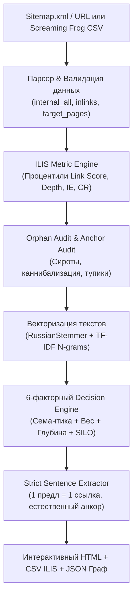

# ILIS v2.0 & Vector Semantic Linker v3.0 — Antigravity Plugin

[](LICENSE)
[]()
[]()
[]()

> Интеллектуальная система анализа внутренней перелинковки, объединяющая отраслевую методологию **ILIS (Internal Linking Intelligence System) v2.0** и алгоритмы векторного семантического связывания. Включает процентильную классификацию, метрики IE и CR, аудит страниц-сирот (Orphan Pages Audit), проверку анкорной каннибализации, 6-факторный взвешенный отбор доноров и импорт выгрузок Screaming Frog CSV.

---

## 🎯 Ключевые возможности ILIS v3.0

| Возможность | Описание |
| :--- | :--- |
| **Два источника данных** | Автономный краулинг по Sitemap/URL либо импорт готовых выгрузок Screaming Frog (`internal_all.csv`, `inlinks.csv`, `target_pages.csv`) |
| **Два режима работы** | **Режим 1 (Target Boost)**: точечное усиление целевых страниц. **Режим 2 (Full Audit)**: полный сквозной аудит всего сайта |
| **Процентильные метрики** | Оценка Link Score, Inlinks и Crawl Depth по процентилям (Top 10%, 10-30%, 30-70%, 70-90%, Bottom 10%) |
| **Метрики IE и CR** | Индекс эффективности распределения веса ($IE = \text{LinkScore} / \text{Outlinks}$) и коэффициент связанности ($CR = \text{Inlinks} / \text{Outlinks}$) |
| **Orphan Pages Audit** | Классификация страниц-сирот (*True Orphan*, *Indexed Orphan*, *Potential Orphan*) с конкретными планами действий |
| **Анкорный риск-аудит** | Выявление анкорной каннибализации (один анкор на разные цели) и неинформативных пустых анкоров («тут», «здесь») |
| **6-факторный отбор доноров** | Взвешенный скоринг: 35% семантика + 25% LinkScore + 15% глубина + 10% Outlinks + 10% SILO + 5% приоритет |
| **Строгая дедупликация** | Гарантия: строго 1 ссылка на 1 уникальное предложение (полный запрет на пересечение ссылок) |
| **Многонаправленность** | Статья ➔ Каталог, Каталог ➔ Каталог (кросс-линкинг описаний), Каталог ➔ Статья (E-E-A-T гиды), Статья ➔ Статья |
| **HTML-блоки для CMS** | Готовые адаптивные виджеты со встроенными стилями для вставки в шаблоны CMS |

---

## 🏗 Архитектура работы (ILIS v2.0 + Vector Pipeline)



---

## 💻 Использование через CLI

### 1. Анализ по Sitemap.xml (автономный веб-краулинг):
```bash
python3 scripts/linker_cli.py \
  --sitemap "https://example.com/sitemap.xml" \
  --articles-pattern "/articles/|/blog/|/news/" \
  --catalog-pattern "/catalog/|/services/|/products/" \
  --output-html "ilis_report.html" \
  --output-csv "ilis_report.csv"
```

### 2. Анализ по выгрузкам Screaming Frog / Sitebulb:
```bash
python3 scripts/linker_cli.py \
  --internal-all "internal_all.csv" \
  --inlinks "inlinks.csv" \
  --target-pages "target_pages.csv" \
  --output-html "ilis_report.html" \
  --output-csv "ilis_report.csv"
```

---

## 🚀 Установка

### В глобальную конфигурацию Antigravity CLI:
```bash
git clone https://github.com/aristovyura23123-commits/antigravity-vector-linker.git ~/.gemini/config/plugins/vector-linker
```

### В проектный каталог агента:
```bash
git clone https://github.com/aristovyura23123-commits/antigravity-vector-linker.git .agents/plugins/vector-linker
```

### Зависимости:
```bash
pip install scikit-learn nltk numpy beautifulsoup4
```

---

## 💻 Использование через CLI

### 1. Анализ по Sitemap.xml
```bash
python3 scripts/linker_cli.py \
  --sitemap "https://example.com/sitemap.xml" \
  --articles-pattern "/articles/|/blog/|/news/" \
  --catalog-pattern "/catalog/|/services/|/products/" \
  --output-html "report.html" \
  --output-csv "report.csv"
```

### 2. Анализ по заданным спискам URL
```bash
python3 scripts/linker_cli.py \
  --articles-urls "url1,url2,url3" \
  --categories-urls "cat1,cat2" \
  --output-html "report.html"
```

---

## 📊 Результаты работы

1. **Интерактивный HTML-дашборд**: визуальная таблица рекомендаций, подсвеченные предложения в статьях, прирост PageRank.
2. **CSV-отчёт для контентщиков**: готовый файл со столбцами `Статья URL`, `Каталог URL`, `Предложение-контекст`, `Рекомендуемый анкор`.
3. **JSON-граф**: матрица смежности и узлы для визуализации графа связей.

---

## 🧪 Тестирование

Запуск модульных тестов:
```bash
python3 -m unittest tests/test_engine.py
```

---

## 📄 Лицензия

MIT License (c) 2026 aristovyura23123-commits.
